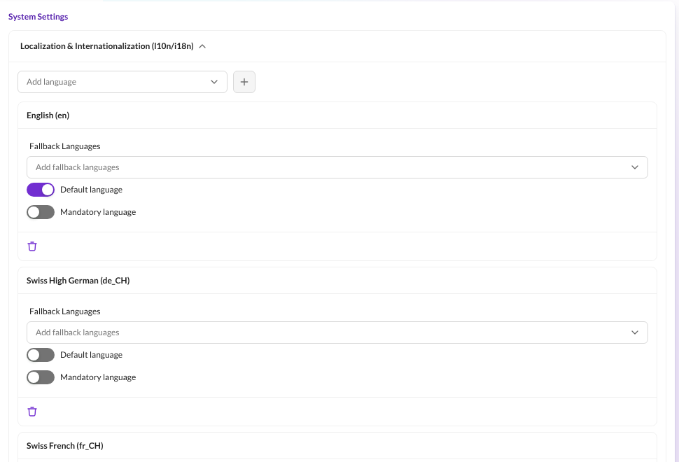
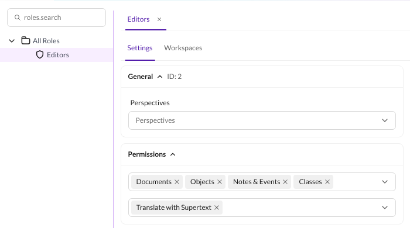

# Installation guide — Supertext Translation for Pimcore

For administrators and developers who install and set up the bundle. Editors find their part in the [user guide](USER_GUIDE.md).

## Requirements

- Pimcore 2026.1 or later with **Pimcore Studio** (`pimcore/studio-backend-bundle` and `pimcore/studio-ui-bundle`; tested with Pimcore 2026.3). The classic admin interface (`admin-ui-classic-bundle`) is not supported.
- PHP 8.4 or 8.5
- At least two languages in Pimcore's system settings (see [Languages](#languages))
- A Supertext account with an API key: [create an account or log in](https://www.supertext.com/person/en/account/signin), then [generate the key](https://www.supertext.com/en/integrations/api) (see [API key](#api-key))
- The server must reach `https://api.supertext.com` over HTTPS

## Install

```bash
composer config repositories.supertext vcs https://github.com/Supertext/Pimcore-Supertext-Translation
composer require supertext/pimcore-supertext-translation:dev-main
```

(Publishing to Packagist is planned; then the first line is no longer needed.)

Register the bundle in `config/bundles.php`:

```php
Supertext\PimcoreTranslationBundle\SupertextTranslationBundle::class => ['all' => true],
```

Then install it and publish its Studio files:

```bash
bin/console pimcore:bundle:install SupertextTranslationBundle
bin/console assets:install public
bin/console cache:clear
```

`pimcore:bundle:install` adds the permission **Translate with Supertext** (`supertext_translate`). The bundle adds:

- a **Translate with Supertext** button to the bottom toolbar of documents (pages, snippets, e-mails…; not folders and links) and data objects (not folders) in Pimcore Studio, for users with that permission,
- the console commands `supertext:translate` and `supertext:check`,
- the public route `GET /supertext/ping` (see [Version information, API key check and ping](#version-information-api-key-check-and-ping)).

### Update

```bash
composer update supertext/pimcore-supertext-translation
bin/console assets:install public
bin/console cache:clear
```

See [CHANGELOG.md](../CHANGELOG.md).

### Uninstall

```bash
bin/console pimcore:bundle:uninstall SupertextTranslationBundle
composer remove supertext/pimcore-supertext-translation
```

and remove the line from `config/bundles.php`. Uninstalling removes the permission. Translations already made are normal documents, object values and versions and stay; so do the notes of type `supertext` that record each translation.

## API key

1. **Supertext account.** No Supertext account yet? [Log in or create a Supertext account](https://www.supertext.com/person/en/account/signin) with your e-mail address.
2. **Generate the key** at [supertext.com → Integrations → API](https://www.supertext.com/en/integrations/api). This requires the **Admin** role in your Supertext account; ask your Supertext account's administrator otherwise.

Set the key as an environment variable, e.g. in `.env.local` or in your hosting's settings:

```bash
SUPERTEXT_API_KEY="your-key"
```

The key may be pasted with or without the `Supertext-Auth-Key ` prefix Supertext shows. Check it (free of charge, nothing is translated):

```bash
bin/console supertext:check
```

```
Supertext Translation for Pimcore 0.1.0 (https://github.com/Supertext/Pimcore-Supertext-Translation/releases/tag/v0.1.0)
API address: https://api.supertext.com/v1/
Languages (Pimcore → Supertext):
  en → en-GB
  de_CH → de-CH (more)
  fr_CH → fr-CH (more)
  it_CH → it-CH (more)
Send version information to Supertext: on (version_reports)
API key checked: the connection to Supertext works.
```

The first line is the installed version of the bundle. Languages without a Supertext language are listed as *not mapped* (see [Languages](#languages)).

Without a key, the translate dialog tells editors that Supertext is not set up yet and shows the two links above; `supertext:check` and the error messages for a rejected key show them too.

## Languages

The bundle translates into the languages set up in Pimcore: **System Settings → Localization & Internationalization (l10n/i18n)**.



- **Data objects:** every language here can be translated into, for the class's localized fields.
- **Documents:** Pimcore keeps one document tree per language, linked as translations. A document's language is its **Language** property (set it on the root page of each language tree; child pages inherit it). Documents without one count as the first language in the list. A new translation is created under the parent page's translation in the target language, so translate the language's root page first (e.g. `/en` into `/de-ch`). Pages directly under *Home* get the target language's code as key (`de-ch`); others get a key made from the translated navigation name or title (`schweizer-schokolade`).

### Supertext languages (language mapping)

Each Pimcore language needs a Supertext language. Supertext accepts exactly these target codes (from its `features` list, October 2026):

| Language | Supertext codes |
| --- | --- |
| German, English, French, Italian, Portuguese | `de-DE`, `de-CH`, `de-AT`, `en-US`, `en-GB`, `fr-FR`, `fr-CH`, `it-IT`, `it-CH`, `pt-PT`, `pt-BR` |
| Chinese, Serbian | `zh-Hans`, `zh-Hant`, `sr-Latn`, `sr-Cyrl` |
| Swiss German | `gsw-u-sd-chzh` (Zurich), `gsw-u-sd-chbe` (Bern) |
| All others, without region | `bg`, `cs`, `da`, `el`, `es`, `fi`, `hr`, `hu`, `ja`, `ko`, `nb`, `nl`, `pl`, `rm`, `ru`, `sk`, `sl`, `sq`, `sv`, `tr` |

- A Pimcore language whose code **is** one of these codes (apart from upper/lower case and `_`/`-`) is used as it is: `de_CH` → `de-CH`, `fr_CH` → `fr-CH`, `es` → `es`.
- Otherwise, as a target, its **obvious default** (since Supertext SDK 0.4.0): a bare `de`, `en`, `fr`, `it`, `pt` → `de-DE`, `en-US`, `fr-FR`, `it-IT`, `pt-PT`; `zh`, `zh_CN` → `zh-Hans`, `zh_TW` → `zh-Hant`; a region of a language Supertext offers without one → the bare code (`es_ES` → `es`, `nl_NL` → `nl`). A mapping overrides it (`de: { code: de-CH }`).
- **Every other language needs a mapping** in the bundle configuration, `languages.<language>.code` (see [Settings](#settings)), e.g. `de_LI: { code: de-CH }`, `en_IE: { code: en-GB }`, `fr_BE: { code: fr-FR }`, `no: { code: nb }`. Nothing else is guessed. An unmapped language is shown as *No Supertext language* in the translate dialog and can't be selected; `supertext:check` lists it as *not mapped*.
- The **source language** is sent without region, from the same mapping (`en` mapped to `en-GB` is sent as `en`; `en_GB` → `en`). The 28 source languages are the languages above without region, plus `gsw` (Swiss German).
- A mapped code is sent as it is, even one this list doesn't have yet (a language Supertext adds later works right away).
- Formal/informal (`politeness`) isn't offered for English, Swiss German, Romansh, Albanian and Serbian. A tone set for one of them is not dropped silently: the dialog marks the language *No formal/informal tone*, and translating into it fails with *Supertext offers no formal or informal tone for this language* until you remove the tone.

## Interface languages

The bundle's Studio screens (the *Translate with Supertext* button and dialog with *Export for translation* and *Import translation*, the permission label and the error messages in the dialog) are available in English, German, French and Italian. They follow each user's Pimcore Studio interface language: the *Language* in the user's profile (user menu → *My profile*; administrators can set it for other users in the user management). Other languages show the English texts. The command-line output, the log and the notes and version comments the bundle writes stay English.

## Permissions

In **System → User & Roles**, give editors' roles (or users):

- the permission **Translate with Supertext**,
- **Documents** and/or **Objects**, and workspaces that let them view the source and save (documents: also create) in the target location,
- for data objects in Pimcore Studio 2026.3 also **Classes**: Studio only opens data objects for users with this permission.



**Export for translation** needs the same permission and *View* on the document or object. **Import translation** needs the permission and, for each document or object in the file, the same rights as translating: *Save* on the existing translation or *Create* on the parent page's translation, or the object language's *Edit* restriction (`lEdit`); elements the user may not edit are reported and left alone.

The dialog shows languages the user may not edit as *Not allowed*: for data objects, the workspace's *Edit* language restrictions (`lEdit`) apply; for documents, the user needs *Save* on an existing translation or *Create* on the parent page's translation. Administrators may do everything.

## Translation files (Export for translation, Import translation)

Nothing to configure: the dialog's **Export for translation** and **Import translation** use the same languages, language mapping, permissions and write-back as *Translate with Supertext*, without calling the Supertext API.

- **Upload size:** at most 10 MB per file. PHP's `upload_max_filesize` and `post_max_size` must allow that (their defaults, 2 MB and 8 MB, are lower; raise them to `10M`/`12M` if editors import large files). The upload is read in memory; nothing is stored besides PHP's own temporary upload file.
- In the file, languages are written with their Supertext code from the mapping; a language without one is written with its Pimcore code (`xx_YY` → `xx-YY`), so it never blocks the export.
- The Studio API endpoints are `GET /pimcore-studio/api/supertext/elements/{document|data-object}/{id}/export?targets=de_CH&format=xliff|html` and `POST /pimcore-studio/api/supertext/import` (multipart field `file`, `includeChanged=1`, `overwrite=1`; header `X-Supertext-Request: 1`).

## Settings

| Setting | Where | Default | Meaning |
| --- | --- | --- | --- |
| `SUPERTEXT_API_KEY` | Environment variable | — | Supertext API key (required). |
| `SUPERTEXT_API_URL` | Environment variable | — | Use another API address, e.g. a test server. Overrides `api_url` and `environment`. |
| `environment` | `supertext_translation` config | `live` | `live` (`https://api.supertext.com/v1/`), `staging` or `testing`. |
| `api_url` | `supertext_translation` config | — | Custom API address (overrides `environment`). |
| `timeout` | `supertext_translation` config | `180` | Seconds to wait for each translation. |
| `poll_interval` | `supertext_translation` config | `2` | Seconds between status checks. |
| `languages.<language>.code` | `supertext_translation` config | the Pimcore code, if it is a Supertext code (`de_CH` → `de-CH`, `es`) | **Language mapping**: the Supertext code for a Pimcore language (see [Supertext languages](#supertext-languages-language-mapping)). Needed for every language whose code isn't a Supertext code (`en`, `de`, `fr`, `zh_CN`, …); there are no default regions. Also used for the source language (in its bare form). |
| `languages.<language>.politeness` | `supertext_translation` config | Supertext's default | Form of address: `more` (formal, e.g. *Sie*), `less` (informal, e.g. *du*). Only for languages Supertext offers it for (not English, Swiss German, Romansh, Albanian, Serbian). |
| `version_reports` | `supertext_translation` config | `true` | **Send version information to Supertext** (see [below](#version-information-api-key-check-and-ping)). `false` turns it off. |
| `SUPERTEXT_VERSION_REPORTS` | Environment variable | — | `0` (or `false`, `off`, `no`) turns version information off, `1` (`true`, `on`, `yes`) on; wins over `version_reports`. |
| `SUPERTEXT_REPORT_URL` | Environment variable | — | Tests only: send version reports to another address (e.g. a stand-in) instead of the Supertext Commando Center. |
| `object_field_types` | `supertext_translation` config | `[input, textarea, wysiwyg]` | Localized field types translated in data objects. |
| `document_editable_types` | `supertext_translation` config | `[input, textarea, wysiwyg, link]` | Editable types translated in documents (for links, the link text). |

Example `config/packages/supertext_translation.yaml`:

```yaml
supertext_translation:
    timeout: 300
    languages:
        en: { code: en-GB }          # Pimcore "en" isn't a Supertext code: map it
        de_CH: { politeness: more }   # de_CH is a Supertext code (de-CH) as it is
        fr_CH: { politeness: more }
        it_CH: { politeness: more }
        pt: { code: pt-BR }
    object_field_types: [input, textarea, wysiwyg]
```

## Version information, API key check and ping

**Send version information to Supertext** (`version_reports`) is on by default. The bundle then sends the site URL and the versions of this bundle, Pimcore and the runtime to Supertext after an update and when the API key changes, so Supertext support can see which version you run. A report contains exactly: the site URL (the address Pimcore serves the back end at; commands use the one last seen, else the domain in Pimcore's system settings), the bundle's name and version, the Pimcore and PHP versions, the Supertext SDK version, whether a key is set, the result of the API key check below (status, time, HTTP status, Supertext's error code) and the address of the ping endpoint. **No content, no API key and no personal data are sent.** Reports go from the Pimcore server after the response has been sent (never from the browser, never slowing down a request); a report that fails is not retried for an hour and never breaks a translation. Set `version_reports: false` in the bundle configuration, or `SUPERTEXT_VERSION_REPORTS=0` in the environment, and clear the cache to turn it off: nothing is sent at all then, and the ping endpoint answers 404.

**The API key check** runs whether or not version information is sent: when the bundle runs (the translate dialog, a translation, `supertext:translate`) with a key it hasn't checked yet (the key in `SUPERTEXT_API_KEY` is compared by a fingerprint kept in the database, never the key itself), when Supertext rejects the key during a translation, and on `supertext:check` (which also sends a `check` report). It's Supertext's cost-free `features` call; nothing is translated or billed. Administrators see the latest result with its time at the bottom of the translate dialog (*Supertext status*), with whether version information is sent and which languages aren't mapped; `supertext:check` prints it too: *the connection works*, *Supertext rejected the API key* (with the links to create an account and generate a key), *no API key is set*, *Supertext can't be reached* or *Supertext answered with an error*.

**The ping endpoint** `GET <site>/supertext/ping?challenge=…` is public (no login, no session) and answers only `{"ok":true,"plugin":"Pimcore-Supertext-Translation","challenge":"…"}` with `Cache-Control: no-store` (so Pimcore's full page cache doesn't keep it), so Supertext can see that the site is reachable from the internet. It returns nothing else: no versions, no settings, no data. If your project's `security.yaml` has a firewall or `access_control` rule that requires a login for every path, allow `^/supertext/ping$` with `PUBLIC_ACCESS`.

The bundle keeps its state (what was reported last, the latest key check, the last site URL) in Pimcore's settings store (table `settings_store`, scope `supertext_translation`).

Translations run while the editor waits (one request per language). Long pages into many languages can take a minute or two: allow PHP's `max_execution_time` and your proxy's timeout accordingly (the bundle raises PHP's limit for these requests where allowed).

## Command line

```bash
# A page into all other languages, as a given Pimcore user
bin/console supertext:translate --document=/en/swiss-chocolate --user=jane
# A data object from English into German and French, replacing existing text
bin/console supertext:translate --object=/Articles/swiss-chocolate --from=en --to=de_CH,fr_CH --overwrite
bin/console supertext:check
```

`--document` and `--object` take an ID or a path. Without `--user`, the first active administrator is used. The same rules apply as in Studio (parent translation, permissions, existing translations).

## Troubleshooting

| Problem | Solution |
| --- | --- |
| No **Translate with Supertext** button | The user needs the permission *Translate with Supertext*. After installing or updating, run `bin/console assets:install public` and `bin/console cache:clear`, then reload Studio. The button is only in Pimcore Studio, not in the classic admin interface. |
| Opening a data object says *You do not have permission to perform this action on this element* | Pimcore Studio 2026.3 requires the **Classes** permission to open data objects. |
| *Supertext is not set up yet* / *No Supertext API key is configured* | Set `SUPERTEXT_API_KEY` (see [API key](#api-key)) and clear the cache. |
| *Authentication failed. Please check the Supertext API key.* | The key is wrong or was revoked. Generate a new one at supertext.com → Integrations → API. |
| *Supertext rejected the API key* (Supertext status, `supertext:check`) | The key is wrong or revoked. Check that the whole key was copied into `SUPERTEXT_API_KEY`, or generate a new one at <https://www.supertext.com/en/integrations/api> (Admin role required). No Supertext account yet? Create one at <https://www.supertext.com/person/en/account/signin>. Then run `bin/console supertext:check`. |
| *The API key couldn't be checked because Supertext can't be reached* | The server can't reach `api.supertext.com` (firewall, proxy, DNS). Translations need the same connection. |
| *The language … has no Supertext language yet* / *No Supertext language* in the dialog / *not mapped* in `supertext:check` | The Pimcore code isn't a Supertext code: add `languages.<language>.code` (see [Supertext languages](#supertext-languages-language-mapping)) and clear the cache. |
| *Supertext offers no formal or informal tone for this language* / *No formal/informal tone* in the dialog | `languages.<language>.politeness` is set for a language without it (English, Swiss German, Romansh, Albanian, Serbian); remove it. |
| A language shows *Translate the parent page first* | Translate the parent page (or the language's root page) into that language first. |
| A language shows *Not allowed* | The user's workspaces don't allow editing that language or creating the page there. |
| *Timed out waiting for the Supertext translation.* | Raise `timeout`; check that the server reaches `api.supertext.com`. |
| *Supertext does not support this language pair (en → xx-YY).* | A mapped `code` Supertext doesn't offer (e.g. `es-ES` instead of `es`, `fr` instead of `fr-FR`/`fr-CH`, or the same language as the source). Fix the mapping; the message shows the codes that were sent. |
| *Too many requests to Supertext.* | The bundle retries automatically; if it persists, try again in a moment. |
| *Your Supertext translation limit is exceeded.* | Your Supertext subscription's limit is used up; contact Supertext. |

Errors from the Supertext API are logged in Pimcore's log with the message shown to the editor.
