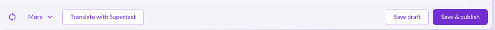
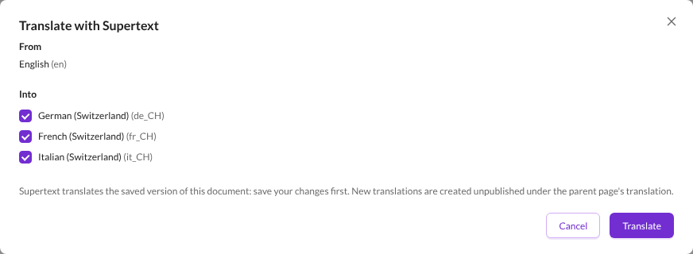
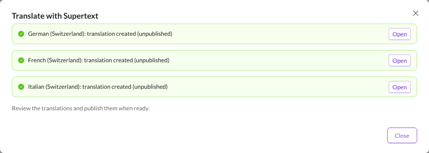
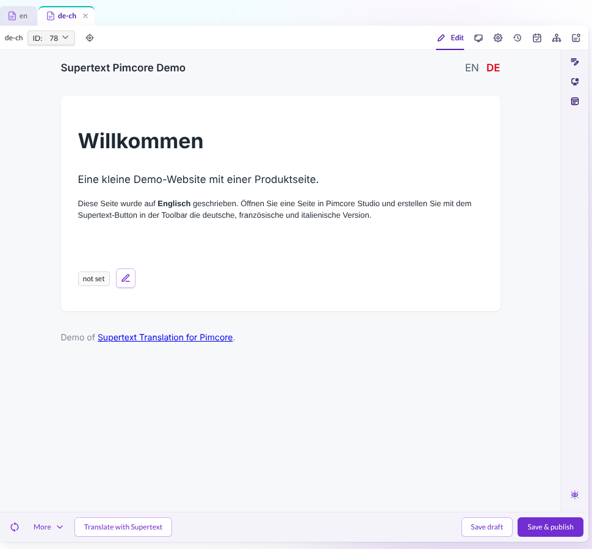
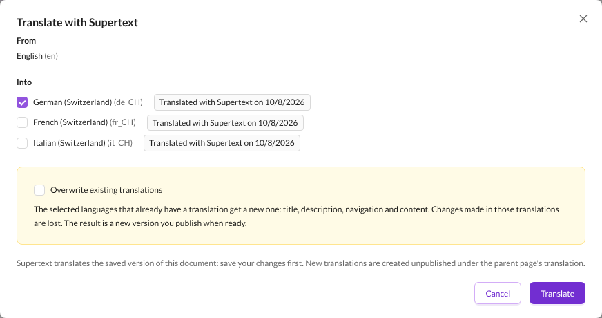
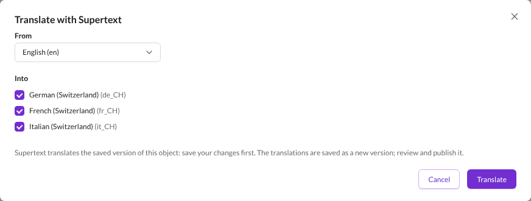
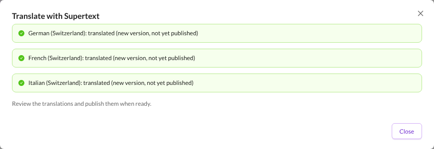
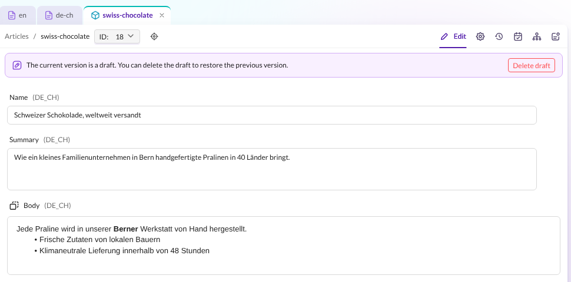

# User guide — Supertext Translation for Pimcore

For editors who translate documents and data objects in Pimcore Studio. Your administrator has installed the bundle, set up the languages and given you the permission *Translate with Supertext* (see the [installation guide](INSTALLATION.md)).

The Supertext button and dialog follow your Pimcore Studio interface language (English, German, French or Italian, set under *My profile*). The messages below are the English texts.

## Translate a page

1. Open the page in the language you translate **from** (e.g. in the `en` tree) and save your changes. Supertext translates the saved version.
2. Click **Translate with Supertext** in the bottom toolbar.

   

3. The dialog shows the page's language under **From**. Under **Into**, the languages without a translation of this page are ticked.

   

4. Click **Translate**. Each language takes a few seconds. The dialog then reports the result per language:

   

A new translation is created as an **unpublished** copy of the page in the target language's tree, under the parent page's translation, and linked to the original as its translation. **Open** shows it.

Translate the pages from the top down: a page can only be translated into a language once its parent page exists in that language (the dialog shows *Translate the parent page first* otherwise). Pages at the top of a language tree, like `/en`, are created directly under *Home*, e.g. as `/de-ch`.

## Review and publish

The translation contains the translated title, description, navigation name and title, and the page's texts. Formatting such as bold text, links and lists stays in place.

Change what you like, as if you had translated by hand, then **Save & publish**. Until you publish, visitors don't see the translation.

- **Translation review:** if your administrator turned on *Translation review* for a language, reviewers (your colleagues or Supertext linguists) check and correct the translations on the website. Their corrections come into Pimcore the next time you translate the document or object into that language: after a review, translate it again with *Overwrite existing translations*. Texts reviewed once keep their corrected wording in later translations.

## Translate again or update a translation

Languages that already have a translation of the page show **Already translated**, or **Translated with Supertext on** *date* if Supertext made it, and are not ticked. If you tick one, the dialog shows an extra option:

- Leave **Overwrite existing translations** off: those languages are skipped (*already translated, skipped*); only missing languages are created. Your edits are safe.
- Turn it on: the existing translations get a new translation of the title, description, navigation and texts. **Changes made in those translations are lost.** The page's key (URL) stays as it is. The result is saved as a new version; the published version stays online until you publish.

## Translate a data object

Data objects (e.g. products or articles) keep all languages in one object, in their localized fields.

1. Open the object and save your changes.
2. Click **Translate with Supertext** in the bottom toolbar.
3. Choose the language to translate **from** (languages that have text). Under **Into**, the languages without text are ticked.

   

4. Click **Translate**.

   

The translations are saved as a **new version** of the object (a draft): when you close the dialog, the editor shows it. Switch the language at the bottom of the editor to check each one:

Then **Save & publish**. Languages that already have text are skipped unless you tick them and turn on **Overwrite existing translations**; then all their translatable fields are replaced.

## Export for translation and import the translated file

Instead of translating with Supertext AI right away, you can export the texts as a file, have them translated elsewhere, and import the translated file. Both are in the **Translate with Supertext** dialog, at the top: **Translate with Supertext** · **Export for translation** · **Import translation**.

**Export for translation**

1. Save your changes (the saved version is exported), open the dialog and choose **Export for translation**.
2. Choose the **File format**:
   - **XLIFF 1.2 (for translation tools)**: the better choice for translators and translation tools (Trados, memoQ, Phrase, …): formatting appears as protected tags, and one file can hold several target languages.
   - **HTML (one language per file)**: can be uploaded to Supertext's web app or translated by anyone who works with HTML. Translators must leave the file's head (the `supertext:` lines) and the `data-st-id` attributes alone. An HTML file can't mark a text as untranslated: imported unchanged, it writes the source text into the target language.
3. Tick the target languages (for data objects, choose the source language first) and click **Download file**. The file is named like `pimcore-document-12-de_CH.xlf` (`pimcore-object-7.xlf` for several languages). It contains the same texts *Translate with Supertext* would send; languages that already have a translation are left out unless you tick **Overwrite existing translations**. *Nothing to translate.* means there are no texts, or every chosen language is already translated.
4. Send the file to your translator, open it in your translation tool, or upload it at supertext.com.

**Import translation**

1. Open the dialog on any document or object and choose **Import translation**. The file itself says which documents, objects and languages it belongs to.
2. Choose the file under **Translated file (XLIFF or HTML)**. Options (both off by default):
   - **Also import texts whose source changed since the export**: a text that was edited in the source language after the export is skipped unless you tick this.
   - **Overwrite existing translations**: a language that got a translation since the export is kept unless you tick this.
3. Click **Import translation**. The texts are saved exactly as by *Translate with Supertext*: a new, unpublished translation of a page, or a new version of an existing translation or of the object. Review and publish as usual.

The dialog shows a summary per document or object and language:

| Line | Meaning |
| --- | --- |
| Imported: 3 | Saved in the target language. |
| Skipped, source changed since the export: 1 | The source text was edited after the export. Export again, or import with *Also import texts whose source changed since the export*. |
| Not translated in the file: 1 | The file has no translation for this text. |
| Formatting changed, not imported: 1 | The translation breaks or adds formatting (tags) the source doesn't have. Fix it in the file and import again. |
| Not in the file: 1 | The text isn't in the file, e.g. one added after the export. |
| Kept, already translated (overwrite is off): 3 | The language already has a translation; tick *Overwrite existing translations* to replace it. |

Errors: *This file isn't a valid XLIFF or HTML translation file.*, *This file wasn't exported by the Supertext bundle, or its header was removed.*, *The file is too large (at most 10 MB).*, *This file belongs to another system (…)* (exported by another Supertext plugin), *The document or data object this file was exported from no longer exists.*, *Pimcore has no language …*, *You are not allowed to edit this translation.*, and the messages of *Translate with Supertext* (e.g. *Translate the parent page into this language first.*). Nothing is saved for an element with an error.

## What is translated

| Content | What happens |
| --- | --- |
| Page title and description (SEO) | Translated |
| Navigation name and title (properties) | Translated |
| Texts: input, textarea, WYSIWYG | Translated; in WYSIWYG, headings, bold, italic, links and lists stay in place, link addresses are kept |
| Links | The link text is translated; the link target is kept |
| Page key (URL) | New translations: made from the translated navigation name or title; kept when overwriting |
| Images, snippets, relations, other editables and settings | Not translated (copied from the original when a translation is created) |
| Data objects: localized input, textarea and WYSIWYG fields | Translated |
| Data objects: other fields, field collections, object bricks, blocks | Not translated |

Empty fields are skipped. Your administrator can change which field and editable types are translated.

## History

Every translation is recorded as a note of type *supertext* on the original document or object (**Notes & Events**), with the languages and who started it. The dialog uses it for *Translated with Supertext on* *date*.

## Messages

| Message | Meaning |
| --- | --- |
| *Supertext is not set up yet* | No API key on the server. Ask your administrator. |
| *already translated, skipped* | That language already had a translation or text, and *Overwrite existing translations* was off. |
| *Translate the parent page first* / *Translate the parent page into this language first.* | The parent page doesn't exist in that language yet. Translate it first. |
| *Not allowed* / *You are not allowed to …* | You may not edit that language or create the page there. Ask your administrator. |
| *This document has no text to translate.* / *The object has no … text to translate from.* | The page or the chosen *From* language is empty. |
| *Authentication failed. Please check the Supertext API key.* | The API key is wrong. Ask your administrator. |
| *Your Supertext translation limit is exceeded.* | Your organisation's Supertext limit is used up. |
| *No Supertext language* (next to a language) / *The language … has no Supertext language yet.* | Supertext has no obvious match for this language, so it can't be selected. Ask your administrator to choose its Supertext language under *Supertext → Settings*; the other languages are translated. |
| *No formal/informal tone* (next to a language) / *Supertext offers no formal or informal tone for this language.* | A formal or informal tone is set for this language, but Supertext doesn't offer one for it (e.g. English). Ask your administrator to remove the tone setting. |
| *Supertext does not support this language pair (en → …).* | Supertext can't translate into this language, or its Supertext language code is wrong. Tell your administrator to check the language under *Supertext → Settings*. |
| *Too many requests to Supertext. Please try again shortly.* | Supertext was busy; try again in a moment. |
| *Timed out waiting for the Supertext translation.* / *The Supertext service is currently unavailable.* | Supertext took too long or is unavailable. Try again later. |

Errors are reported per language: if one language fails, the others are still translated.

Administrators also see a short **Supertext status** at the bottom of the dialog: the latest check of the API key with its time, the languages without a Supertext language, and whether version information is sent to Supertext (see the [installation guide](INSTALLATION.md#version-information-api-key-check-and-ping)).
